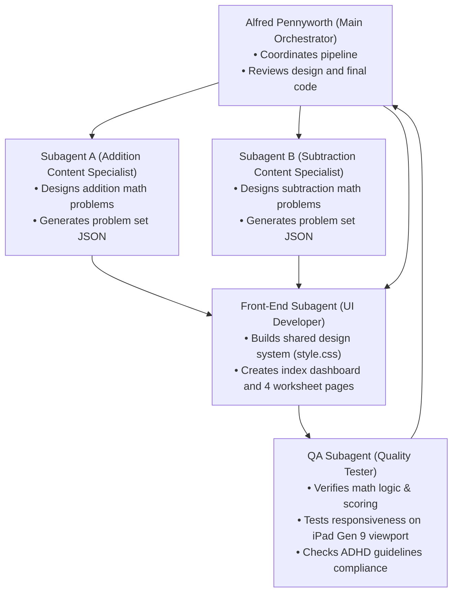

# Design Specification: Mini-Math Workshop Worksheet Library (K3 ADHD)
**Date:** 2026-06-06  
**Status:** Approved  
**Target Device:** iPad Gen 9 (2160 × 1620 px)

---

## 1. Overview & Purpose
This project aims to build a digital educational worksheets library for Kindergarten 3 (K3) children, with special ADHD considerations (vibrant colors, clean minimal layouts, instant positive reinforcement, and short sessions). The library will focus on two core mathematical skills:
* **Single-digit Addition**
* **Single-digit Subtraction**

---

## 2. Agent & Subagent Architecture (Family Tree)
To deliver this project systematically and with high quality, the work is divided among specialized agents:

### Roles and Responsibilities:
1. **Alfred (Main Orchestrator):** Approves the specification, coordinates subagents, handles permission delegation, and performs final code integration.
2. **Subagent A (Addition Content Specialist):** Generates 10 addition problems with corresponding SVG/Unicode visual representations for counting, separated into interactive and static worksheets.
3. **Subagent B (Subtraction Content Specialist):** Generates 10 subtraction problems with visual representations, separated into interactive and static worksheets.
4. **Front-End Subagent:** Implements standard HTML/JS/CSS based on coordinates/JSON inputs. Implements `style.css` (Shared Design System) and `index.html` (Index Dashboard).
5. **QA Subagent:** Inspects pages for bugs, performs input value verification, screen dimension validation, and scoring verification.

---

## 3. Product Features & Files

The project will generate a total of 6 files in the workspace:

### 3.1. Shared Design System (`style.css`)
* **Theme:** Bright and playful, using primary tones like blue, soft yellow, and pastel backgrounds to reduce sensory overload (minimalist ADHD design).
* **Grid system:** Flexbox and CSS Grid centered around an A4 page aspect ratio for the static pages and a full-height layout for the interactive games.
* **Colors:**
  * `--primary`: `#1565C0` (Calming deep blue)
  * `--secondary`: `#42A5F5` (Friendly sky blue)
  * `--success`: `#4CAF50` (Encouraging green)
  * `--bg`: `#FAFCFF` (Off-white pastel blue background to reduce glare)

### 3.2. Index Dashboard (`index.html`)
* A portal showing 2 main cards: **Addition (บวกเลข)** and **Subtraction (ลบเลข)**.
* Each card links to two sub-pages: **Interactive Play (โต้ตอบบนหน้าจอ)** and **Pencil Practice (เขียนทับด้วยปากกา)**.
* ADHD-friendly minimalist navigation with large click targets.

### 3.3. Addition Worksheets
1. **Interactive Version (`worksheet_add_interactive.html`):**
   * Multi-choice or tap-to-answer game interface.
   * Instant feedback: Happy sounds/animations (stars rising, confetti effect) when answering correctly.
   * Progression tracker (e.g. 10 stars to fill).
2. **Static Version (`worksheet_add_static.html`):**
   * Traditional worksheet layout styled nicely.
   * Empty fields for text input or Apple Pencil annotation.
   * Printable using `@media print`.

### 3.4. Subtraction Worksheets
1. **Interactive Version (`worksheet_sub_interactive.html`):**
   * Simple drag-and-drop or text answer verification.
   * Visual helper (e.g., crossing out objects when subtracting).
2. **Static Version (`worksheet_sub_static.html`):**
   * Clean subtraction table and problem sets.
   * Structured writing lanes suitable for handwriting practice on iPad.

---

## 4. Technical Constraints & Success Criteria
* **Guided Access Compatibility:** No external popups, page jumps, or links to external websites that children can click to exit the learning session.
* **Offline First:** All stylesheets and scripts must be local and self-contained (no external CDN loads of Tailwind, FontAwesome, etc.).
* **Viewport Support:** Built and tested specifically to fit standard 4:3 iPad viewports (`1024x768` logic pixels / `2160x1620` physical pixels).
* **Code Cleanliness:** No placeholder code. Clean, modular Javascript handlers for interactive worksheets.
